  

  
  &nbsp;
  

## About me

- 🛡️ **Currently** — LLM safety: adversarial prompting evals & rigor harnesses. Finding where models break, before users do.
- 🔌 **Building** — **Sub2API**: one gateway for Claude / OpenAI / Gemini / Grok subscriptions. Stop juggling API keys.
- 🤖 **Also** — coding agents in Rust & TypeScript that do real work: build, test, ship.
- 📍 **Based in** — Granada, Spain.

## Tech stack

  

## GitHub stats

  
  

  

## Selected work

  
  
  
  

## Contributions

  <picture>
    <source media="(prefers-color-scheme: dark)" srcset="https://raw.githubusercontent.com/tamseno/tamseno/output/github-contribution-grid-snake-dark.svg" />
    
  </picture>

---

  

© 2026 Ezra Tam · Granada, Spain

